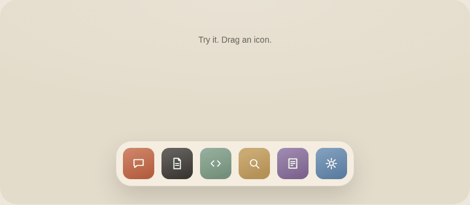

# docK — a draggable dock your AI assistant can build

**Like the dock? Give this repo link to your AI assistant.**

A macOS-inspired dock interaction with **spring animation, drag-to-reorder, removal, undo, and keyboard controls**. The motion spec, reference code, and optional Model Context Protocol (MCP) server help your assistant adapt it to your project.

**[Try the live demo](https://rishabharora-kk.github.io/docK/) · [AI integration guide](IMPLEMENTATION.md) · [Motion spec](spec.json) · [MIT license](LICENSE)**

### [Try the interactive dock →](https://rishabharora-kk.github.io/docK/)

No install. No sign-in. Open and drag.

[](https://rishabharora-kk.github.io/docK/)

GitHub READMEs cannot run JavaScript. Click the preview to use the real interactive dock.

## Get it in your project

Copy this into your AI coding assistant:

```text
Add this dock interaction to my project: https://github.com/rishabharora-kk/docK
Read IMPLEMENTATION.md, spec.json, and index.html from the repo. Adapt it to
my stack and existing design, preserve pointer and keyboard behaviour,
and verify the interaction scenarios. Use my app's icons and actions.
```

Your assistant needs repository/file access. **No MCP setup is required:** the files carry the implementation instructions. If you prefer MCP, the [implementation guide](IMPLEMENTATION.md#optional-mcp-connection) explains how to connect the local server and use its build plans and checks. Sharing the link does not automatically connect MCP.

## Why docK?

Most of the work is in the interaction details: an icon that stays under your pointer, neighbours that make room, a stable landing slot, cancellation, and recovery. docK packages those behaviours as a runnable reference plus a machine-readable specification so an AI assistant has concrete values and scenarios to work from.

- **Try before integrating:** a self-contained HTML demo, no build step or browser dependencies.
- **Give your AI the link:** instructions, state transitions, spring tokens, invariants, and test scenarios live in the repo.
- **Choose your stack:** a vanilla JavaScript reference plus build-plan guidance for React, Vue, Svelte, and SwiftUI. These are not prebuilt framework packages.
- **Keep control:** keyboard interaction, focus handling, live announcements, reduced motion, and undo are part of the reference.
- **Reuse it:** code and documentation are MIT licensed. Preserve the license notice when copying.

## Try these gestures

- **Reorder:** drag an icon sideways. The outline shows where it will land.
- **Remove:** drag above the dock and release. Use **Undo** or **Ctrl/Cmd+Z** to restore it.
- **Cancel:** press **Esc** to return the icon to its original position.
- **Keyboard:** Tab to an icon, Space or Enter to pick up, arrow keys to move, Space or Enter to drop. Delete removes a picked-up icon.
- **Inspect:** enable Slow motion, or expand the interaction design notes below the demo.

## Use it locally

Open [`index.html`](index.html) in a modern browser. No dependencies or build step. The demo runs entirely in your browser; it does not upload your interactions.

The animation uses direct pointer positioning for the held icon, spring physics for its neighbours, deferred order commits, separate removal thresholds, and reversible removal. Native buttons, live announcements, keyboard controls, and reduced-motion support provide alternative ways to use it.

## Source map

| File | Purpose |
| --- | --- |
| [`index.html`](index.html) | Self-contained interactive demo and implementation |
| [`IMPLEMENTATION.md`](IMPLEMENTATION.md) | Start here: integration guide for AI assistants |
| [`spec.json`](spec.json) | Original interaction specification from the design bundle |
| [`UX-REVIEW.md`](UX-REVIEW.md) | Design evaluation, improvements, and remaining validation |
| [`server.py`](server.py) | Optional MCP server for exploring the supplied specification |
| [`reference/index.html`](reference/index.html) | Bundled reference for the MCP server |

To run the optional MCP server: `python -m pip install -r requirements.txt`, then `python server.py`. It is separate from the browser demo.

## Contribute or show what you built

Found a reproducible interaction bug, improved the touch experience, or adapted the dock to a framework? See [CONTRIBUTING.md](CONTRIBUTING.md). Include your stack, a demo or recording, and the scenarios you checked. If the project helps you, a star makes it easier to find again.

## License

[MIT](LICENSE) © 2026 rishabharora-kk. Personal and commercial reuse is allowed under the license terms.

## Hosting

The [live demo](https://rishabharora-kk.github.io/docK/) is hosted on GitHub Pages from `main`, repository root. No build step. The README preview opens the interactive page because GitHub READMEs cannot execute JavaScript.

Maintainer resources: [discovery audit and next steps](docs/DISCOVERY.md) · [launch copy and assets](docs/LAUNCH.md).
