# docK

**Pick up. Move aside. Put down.** A tactile dock where the icon follows your hand and its neighbours make room.

### [Try the interactive dock →](https://rishabharora-kk.github.io/docK/)

No install. No sign-in. Open and drag.

GitHub READMEs cannot run JavaScript. Click the preview to use the real interactive dock.

## Try these gestures

- **Reorder:** drag an icon sideways. The outline shows where it will land.
- **Remove:** drag above the dock and release. Use **Undo** or **Ctrl/Cmd+Z** to restore it.
- **Cancel:** press **Esc** to return the icon to its original position.
- **Keyboard:** Tab to an icon, Space or Enter to pick up, arrow keys to move, Space or Enter to drop. Delete removes a picked-up icon.
- **Inspect:** enable Slow motion, or expand the interaction design notes below the demo.

## Use it locally

Open [`index.html`](index.html) in a modern browser. No dependencies or build step. The demo runs entirely in your browser; it does not upload your interactions.

The animation uses direct pointer positioning for the held icon, spring physics for its neighbours, deferred order commits, separate removal thresholds, and reversible removal. Native buttons, live announcements, keyboard controls, and reduced-motion support provide alternative ways to use it.

## Source map

| File | Purpose |
| --- | --- |
| [`index.html`](index.html) | Self-contained interactive demo and implementation |
| [`spec.json`](spec.json) | Original interaction specification from the design bundle |
| [`UX-REVIEW.md`](UX-REVIEW.md) | Design evaluation, improvements, and remaining validation |
| [`server.py`](server.py) | Optional MCP server for exploring the supplied specification |
| [`reference/index.html`](reference/index.html) | Bundled reference for the MCP server |

To run the optional MCP server: `python -m pip install -r requirements.txt`, then `python server.py`. It is separate from the browser demo.

## Hosting

The demo is served by GitHub Pages from `main` at the repository root. Changes to `index.html` publish through GitHub's Pages build. The README preview links straight to that demo.
